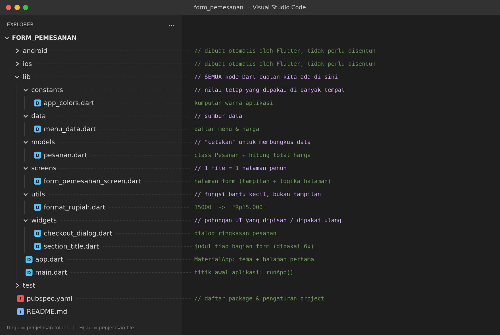
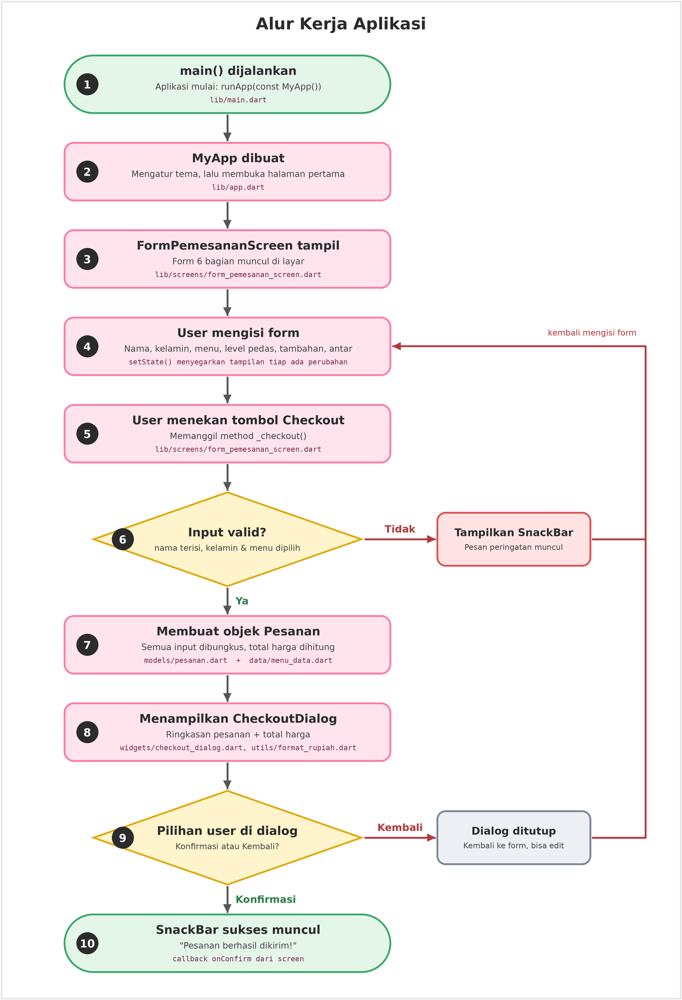

# 🍜 Form Pemesanan Makanan (Flutter)

Aplikasi sederhana untuk memesan makanan: isi nama, pilih menu, atur level pedas,
tambah pelengkap, lalu checkout dan lihat ringkasan beserta total harganya.

---

## 1. Cara menjalankan

1. Buat project Flutter baru: `flutter create form_pemesanan`
2. **Ganti** folder `lib/` di project itu dengan folder `lib/` dari repo ini.
   (Folder `docs/` isinya gambar untuk README saja, boleh disalin biar gambarnya muncul.)
3. Jalankan `flutter run`.

---

## 2. Struktur folder

Begini tampilannya kalau dibuka di **Visual Studio Code** (panel *Explorer* di sebelah kiri).
Tulisan di sebelah kanan adalah penjelasan tiap folder/file:

Cara membacanya:

- Folder `android`, `ios`, `test`, dan file `pubspec.yaml` dibuat otomatis oleh Flutter. Pemula tidak perlu mengubahnya.
- Semua kode yang kita tulis ada di dalam `lib/`.
- Di dalam `lib/`, **folder ditaruh di atas, file di bawah** (urutan bawaan VS Code). Jadi `app.dart` dan `main.dart` ada di paling bawah.

---

## 3. Kenapa harus dikelompokkan ke folder?

Awalnya semua kode ada di satu file `main.dart` (±500 baris). Itu masih jalan,
tapi punya masalah:

| Masalah di satu file | Solusinya |
|---|---|
| Susah mencari kode ("harga ada di mana ya?") | Tiap jenis kode punya "rumah" sendiri |
| Mau ubah harga, malah takut merusak tampilan | Data dipisah dari tampilan |
| Kode yang sama ditulis berulang | Dijadikan widget/fungsi yang dipakai ulang |
| Kerja kelompok bentrok (edit file yang sama) | Tiap orang bisa edit file berbeda |
| File panjang bikin pusing dibaca | Satu file = satu tugas |

Prinsipnya disebut **Separation of Concerns**: *satu file/class mengurus satu hal saja.*

### Penjelasan tiap folder

**`constants/`** — nilai tetap yang dipakai di banyak tempat (warna, ukuran, teks).
Dulu `Colors.pinkAccent` ditulis berkali-kali. Sekarang cukup `AppColors.utama`;
mau ganti tema tinggal ubah satu baris.

**`data/`** — sumber data. Sekarang masih berupa `Map` biasa. Nanti kalau
datanya mau diambil dari internet/database, yang diubah cukup folder ini.

**`models/`** — "cetakan" data. Class `Pesanan` membungkus nama, menu, tambahan,
level pedas, dan pengantaran jadi satu objek. Logika hitung total harga juga ikut
di sini karena itu urusan *data*, bukan urusan *tampilan*.

**`utils/`** — fungsi bantu kecil yang tidak peduli soal tampilan, misalnya
`formatRupiah()`. Bisa dipakai di mana saja.

**`screens/`** — satu file = satu halaman penuh. Berisi `Scaffold`, form, dan
logika halaman tersebut.

**`widgets/`** — potongan UI yang bisa dipakai ulang atau cukup besar sehingga
lebih rapi dipisah (`SectionTitle`, `CheckoutDialog`).

---

## 4. Alur kerja aplikasi

Ikuti panah dari atas ke bawah. Angka di tiap kotak sesuai dengan tabel di bawah gambar.

Warna kotak:
- 🟩 hijau: awal / akhir alur
- 🟪 pink: proses biasa
- 🟨 kuning: percabangan (ada pilihan Ya/Tidak)
- 🟥 merah / abu-abu: jalur balik ke form

| No | Kejadian | File yang terlibat |
|---|---|---|
| 1 | Aplikasi dijalankan, `runApp()` memanggil `MyApp` | `main.dart` |
| 2 | `MyApp` mengatur tema dan menentukan halaman pertama | `app.dart` |
| 3 | Halaman form tampil | `screens/form_pemesanan_screen.dart` |
| 4 | User mengisi form. Tiap perubahan memanggil `setState()` | `screens/form_pemesanan_screen.dart` |
| 5 | User menekan **Checkout**, method `_checkout()` jalan | `screens/form_pemesanan_screen.dart` |
| 6 | Validasi: nama harus terisi, jenis kelamin dan menu harus dipilih. Kalau gagal, muncul SnackBar lalu user balik ke langkah 4 | `screens/form_pemesanan_screen.dart` |
| 7 | Input dibungkus jadi objek `Pesanan`, total harga dihitung | `models/pesanan.dart`, `data/menu_data.dart` |
| 8 | Dialog ringkasan tampil, harga diformat jadi `Rp...` | `widgets/checkout_dialog.dart`, `utils/format_rupiah.dart` |
| 9 | User memilih **Kembali** (balik ke form) atau **Konfirmasi** | `widgets/checkout_dialog.dart` |
| 10 | Kalau konfirmasi, SnackBar "Pesanan berhasil dikirim!" muncul | `screens/form_pemesanan_screen.dart` |

Perhatikan bahwa **tiap langkah ditangani file yang berbeda**. Itulah gunanya
folder dipisah: kalau ada bug di perhitungan harga, langsung buka
`models/pesanan.dart`; kalau tampilannya yang aneh, buka `screens/` atau `widgets/`.

---

## 5. Konsep Flutter yang dipakai (buat belajar)

**StatelessWidget vs StatefulWidget**
- `StatelessWidget`: tampilan tetap, tidak berubah sendiri (`MyApp`, `SectionTitle`, `CheckoutDialog`).
- `StatefulWidget`: tampilan bisa berubah mengikuti data (`FormPemesananScreen`),
  karena pilihan user berubah-ubah.

**`setState(() { ... })`**
Memberi tahu Flutter: "data berubah, gambar ulang layar." Tanpa ini, nilai
variabel berubah tapi layar tidak ikut berubah.

**`TextEditingController` + `dispose()`**
Controller dipakai untuk membaca isi `TextField`. Wajib di-`dispose()` saat halaman
ditutup supaya tidak memakan memori.

**`Form` + `validator`**
`_formKey.currentState!.validate()` menjalankan semua `validator` di dalam form.
Kalau ada yang mengembalikan teks error, pesan itu muncul di bawah field.

**Memecah `build()` jadi method kecil**
Method `_buildNama()`, `_buildMenu()`, dst. membuat `build()` terbaca seperti
daftar isi. Awalan `_` artinya *private* (hanya dipakai di file itu).

**Callback (`onConfirm`)**
`CheckoutDialog` tidak tahu apa yang harus terjadi setelah konfirmasi, jadi ia
menerima fungsi `onConfirm` dari luar. Dengan begitu dialog bisa dipakai ulang.

**Spread operator `...`**
`...list.map(...)` memasukkan hasil `map` sebagai anak-anak langsung ke dalam
`children`.

**Getter (`get totalHarga`)**
Nilai yang dihitung otomatis dari data lain, ditulis seperti properti biasa.

---

## 6. Ide pengembangan

- Tambah jumlah porsi per menu (qty).
- Simpan riwayat pesanan.
- Pindahkan data menu ke class `MenuItem` (nama, harga, gambar).
- Coba state management seperti Provider kalau aplikasi makin besar.

## 7. Catatan versi Flutter

Di Flutter terbaru, `activeColor` pada `SwitchListTile` dan `RadioListTile`
(`groupValue`/`onChanged`) mungkin muncul peringatan *deprecated*. Itu hanya
warning, aplikasi tetap jalan. Boleh diperbarui nanti setelah paham dasarnya.
